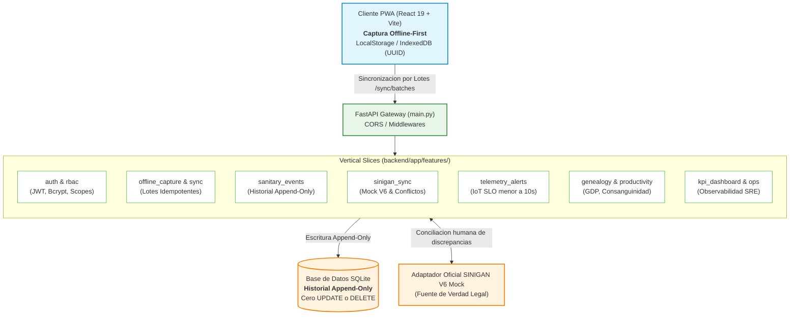
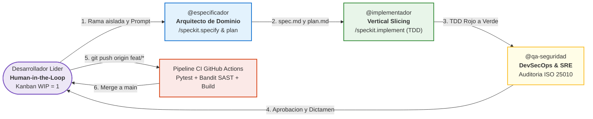

# BovinoTech IoT - Plataforma de Trazabilidad Ganadera (SDD + Multiagente)

Plataforma agroindustrial offline-first para la gestion sanitaria, trazabilidad bovina compatible con **SINIGAN V6** y monitoreo telemetrico IoT en entornos rurales con conectividad intermitente.

Proyecto desarrollado bajo **Spec-Driven Development (SDD)** con **GitHub Spec Kit** y una arquitectura **Multiagente (Modalidad B)** para el curso de *Procesos Modernos de Desarrollo de Software* (Universidad EAFIT).

---

## Arquitectura y Stack Tecnologico

- **Metodologia:** Spec-Driven Development (SDD) + Test-Driven Development (TDD) + Vertical Slicing.
- **Orquestacion IA:** GitHub Spec Kit (specify-cli) + Gemini CLI (@google/gemini-cli) con 3 agentes diferenciados en .github/agents/.
- **Backend:** Python 3.12, FastAPI, SQLAlchemy (SQLite), Pydantic, Pytest, Bandit (SAST).
- **Frontend:** React 19, Vite (PWA), ESLint.
- **CI/CD y DevSecOps:** GitHub Actions (.github/workflows/ci.yml).

---

## Arquitectura de la Solución (BovinoTech IoT)

BovinoTech IoT está diseñada como una arquitectura agroindustrial desacoplada mediante **Rebanadas Verticales (*Vertical Slicing*)**, preparada para entornos rurales hostiles con conectividad intermitente (*Offline-First*) y sujeta a estricta auditoría sanitaria oficial.

### Diagrama General de Arquitectura

### Patrones de Arquitectura Fundamentales

1. **Rebanadas Verticales (*Vertical Slicing*) y Desacoplamiento por `din`:**
   * Cada historia reside en su carpeta independiente (`features/<modulo>/`) con sus propios modelos, esquemas, servicios y componentes UI.
   * Ningún módulo tiene claves foráneas bloqueantes contra tablas de otras historias en desarrollo concurrente. Todas las entidades se vinculan mediante el identificador estándar del animal (`din`, ej. `DIN-DEMO-0001`).
2. **Operación Offline-First y Sincronización Idempotente:**
   * En el potrero sin red, las capturas se registran en menos de 2 segundos en el cliente asignando un identificador universal único (`client_event_id` UUIDv4).
   * Al recuperar conectividad, el endpoint `/sync/batches` procesa lotes de forma idempotente: eventos ya registrados responden como `DUPLICADO` sin corromper ni duplicar datos.
3. **Historial Sanitario Inmutable (*Append-Only*):**
   * Por regulación agropecuaria y trazabilidad, está prohibido ejecutar sentencias `UPDATE` o `DELETE` destructivas sobre eventos sanitarios.
   * Toda corrección veterinaria crea un nuevo registro vinculado al original mediante `corrected_event_id`, registrando obligatoriamente el motivo, autor con rol `VETERINARIO` y marca temporal UTC.
4. **Interoperabilidad Oficial (SINIGÁN V6) y Conciliación Humana:**
   * El adaptador de SINIGÁN V6 actúa como fuente de verdad legal para propiedad, sexo y predio. Si la captura de campo difiere de la base oficial, nunca se sobrescribe automáticamente: se crea un ticket de conflicto para decisión médica veterinaria.

---

## Topología Multiagente y Gobernanza (Modalidad B)

La gobernanza de desarrollo se estructura bajo una **Topología de 3 Agentes Especializados con Supervisión Humana Continua (*Human-in-the-Loop*)**, operando bajo la metodología Lean-Kanban con límite estricto de **WIP = 1** por integrante.

### Diagrama de Topología y Flujo de Trabajo

### Matriz de Roles y Responsabilidades

| Agente / Rol | Archivo de Contexto | Idioma y Enfoque | Responsabilidades Principales | Lo que TIENE PROHIBIDO hacer |
|---|---|---|---|---|
| **Humano en el Bucle** (*Líder*) | Documento E2E / Backlog | Español / Toma de Decisiones | Define prioridades Kanban (WIP=1), formula prompts, supervisa la conciliación y aprueba los Pull Requests hacia `main`. | Aprobar cambios sin pruebas automatizadas o que violen la constitución. |
| **`@especificador`** | `.github/agents/especificador.agent.md` | **Español** (Negocio) | Ejecuta `/speckit.specify`, `/speckit.plan` y `/speckit.tasks`. Redacta el QUÉ funcional (`Given/When/Then`), contratos Pydantic y desglose de tareas ordenadas por TDD. | **Prohibido escribir código productivo**, implementar frameworks en `spec.md` o alterar la arquitectura base. |
| **`@implementador`** | `.github/agents/implementador.agent.md` | **Inglés** (Código) / **Español** (UI) | Ejecuta `/speckit.implement`. Escribe pruebas TDD en `backend/tests/` (rojo), implementa el backend en `features/<modulo>/`, frontend en React y registra en `main.py`/`App.jsx`. | **Prohibido modificar carpetas de otros módulos**, usar `UPDATE`/`DELETE` destructivos o exponer credenciales. |
| **`@qa-seguridad`** | `.github/agents/qa-seguridad.agent.md` | **Español** (Auditoría) | Audita código contra `ISO/IEC 25010:2023` y `NISTIR 8259A`. Verifica latencia de alertas (< 10 s), RBAC, contratos tipados, Bandit SAST y suite de pruebas en verde. | **Prohibido dar visto bueno si hay hallazgos de seguridad**, colisiones de carpetas o pruebas fallidas. |

---

---

## Guia de Instalacion Rapida para el Equipo

### Prerrequisitos
- Git
- Python 3.11+
- Node.js 20+ (incluye npm)
- Cuenta de Google (para usar Gemini CLI gratuitamente)

### 1. Clonar el Repositorio
    git clone [https://github.com/MBece/bovinotech-iot-sdd.git](https://github.com/MBece/bovinotech-iot-sdd.git)
    cd bovinotech-iot-sdd

### 2. Configurar y Levantar el Backend (FastAPI)
En Windows (PowerShell):
    cd backend
    python -m venv .venv
    .\.venv\Scripts\Activate.ps1
    pip install -r requirements.txt
    pytest
    uvicorn app.main:app --reload

(En Mac/Linux activa el entorno con: source .venv/bin/activate)
- API disponible en: [http://127.0.0.1:8000](http://127.0.0.1:8000)
- Documentacion interactiva (Swagger): [http://127.0.0.1:8000/docs](http://127.0.0.1:8000/docs)

### 3. Configurar y Levantar el Frontend (React + Vite)
En otra terminal, desde la raiz del proyecto:
    cd frontend
    npm install
    npm run dev

- Aplicacion disponible en: http://localhost:5173

### 4. Credenciales de Prueba Preconfiguradas (Seed Data)

El sistema inicializa automáticamente las siguientes cuentas institucionales de prueba para evaluar el control de acceso por roles (RBAC) y el aislamiento de fincas:

| Rol | Correo Institucional | Contraseña | Fincas Asignadas | Alcance y Permisos en la Demostración |
|---|---|---|---|---|
| **`ADMINISTRADOR`** | `admin@bovinotech.co` | `Password123!` | `FINCA-01`, `FINCA-02` | Aprovisionamiento de usuarios, asignación de predios y auditoría de accesos. |
| **`OPERARIO`** | `operario@bovinotech.co` | `Password123!` | `FINCA-01` | Captura offline en campo; **acceso denegado** a costos y validaciones clínicas. |
| **`VETERINARIO`** | `vet@bovinotech.co` | `Password123!` | `FINCA-01`, `FINCA-02` | Validaciones clínicas, correcciones *append-only* y resolución de conflictos SINIGÁN. |
| **`DIRECTIVO`** | `directivo@bovinotech.co` | `Password123!` | `FINCA-01`, `FINCA-02` | Tablero ejecutivo de indicadores, GDP, costos y reportes consolidados. |

> 💡 **Tip:** En la interfaz web (`http://localhost:5173`), la pantalla de inicio cuenta con botones de **Acceso Rápido** que permiten alternar entre estos roles con un solo clic para agilizar la sustentación.

### 5. Instalar Herramientas SDD (GitHub Spec Kit + Gemini CLI)
    pip install git+https://github.com/github/spec-kit.git
    npm install -g @google/gemini-cli

Inicia gemini en la raiz del proyecto (la primera vez pedira autenticar con cuenta de Google en el navegador).

---

## Flujo de Trabajo SDD Multiagente (Obligatorio por Historia)

> 📖 **Guía Completa de Contribución:** Consulta [CONTRIBUTING.md](CONTRIBUTING.md) para ver la guía detallada de comandos Git, verificación pre-push y el manual de revisión y aprobación de Pull Requests.

1. Crear rama aislada: git checkout -b feat/hu-0X-nombre-modulo
2. Abrir Gemini CLI: gemini
3. Especificar (@especificador): Ejecutar /speckit.specify describiendo el QUE (sin tecnologias, respetando constitution.md).
4. Planificar (@especificador): Ejecutar /speckit.plan definiendo el COMO dentro de backend/app/features/<modulo>/ y frontend/src/features/<modulo>/.
5. Desglosar Tareas: Ejecutar /speckit.tasks
6. Implementar con TDD (@implementador): Ejecutar /speckit.implement (pruebas primero en backend/tests/, luego codigo).
7. Auditar y Validar (@qa-seguridad): Verificar seguridad, correr pytest y npm run build.
8. Subir cambios: git push -u origin feat/hu-0X-nombre-modulo y abrir Pull Request hacia main.

---

## Historias de Usuario del Proyecto (Backlog MVP)

> 📄 **Documentación Completa:** Para ver el detalle técnico, contratos exhaustivos y criterios *Given / When / Then*, consulta [HISTORIAS_USUARIO.md](HISTORIAS_USUARIO.md) y la [Guía de Sustentación](guia_presentacion.md).

### Matriz de Distribución y Alcance

| HU | Módulo (`features/`) | Rol Principal | Enfoque / Regla Crítica | Bloque |
|---|---|---|---|---|
| **HU-01** | `auth` | `ADMINISTRADOR` | RBAC estricto, sin autorregistro, autenticación JWT con bcrypt | Línea Base |
| **HU-02** | `offline_capture` | `OPERARIO` | Captura local en potrero, UUID `client_event_id`, offline-first | Línea Base |
| **HU-03** | `offline_sync` | `OPERARIO` / Sistema | Sincronización idempotente por lotes (`/sync/batch`), reintentos | Línea Base |
| **HU-04** | `sanitary_events` | `VETERINARIO` | Catálogo cerrado, historial inmutable *Append-Only* (`corrected_event_id`) | Línea Base |
| **HU-05** | `sinigan_sync` | `VETERINARIO` | Adaptador simulado SINIGÁN V6, conciliación humana de conflictos | Línea Base |
| **HU-06** | `telemetry_alerts` | `OPERARIO` / `VETERINARIO` | Detección de inmovilidad (>6h) y salida de potrero, latencia SLO < 10 s | Demostración en Vivo |
| **HU-07** | `genealogy` | `VETERINARIO` | Árbol 3 generaciones, validación anti-ciclos y alerta de consanguinidad | Demostración en Vivo |
| **HU-08** | `productivity` | `DIRECTIVO` | Ganancia Diaria de Peso (GDP), eficiencia alimenticia y pesajes atípicos | Demostración en Vivo |
| **HU-09** | `kpi_dashboard` | `DIRECTIVO` / `VETERINARIO` | Tablero ejecutivo auditable, métricas validadas vs pendientes | Demostración en Vivo |
| **HU-10** | `observability_ops` | Equipo DevOps / SRE | Observabilidad técnica, `correlation_id`, SLI/SLO y Error Budget | Transversal / Demo |

---

### Detalle de Historias de Usuario

#### 🟢 Bloque 1: Línea Base (Arquitectura y Operación Rural)
* **HU-01 — Gestión de Identidad y Control de Acceso por Roles (`auth`):**
  * *Como* administrador quiero aprovisionar cuentas asignando roles (`ADMINISTRADOR`, `OPERARIO`, `VETERINARIO`, `DIRECTIVO`) y fincas, *para* garantizar que cada usuario acceda únicamente a las operaciones autorizadas.
  * *Regla clave:* Cero autorregistro público; contraseñas con bcrypt; sesiones locales válidas ante pérdida de red.
* **HU-02 — Captura Offline de Eventos Sanitarios en Campo (`offline_capture`):**
  * *Como* operario quiero registrar vacunaciones, tratamientos, chequeos clínicos y desparasitaciones en el potrero sin internet, *para* evitar la pérdida de datos operativos.
  * *Regla clave:* Identificador único `client_event_id` (UUID); almacenamiento local inmediato (< 2 s); estados `PENDIENTE_SINCRONIZACION` y `PENDIENTE_VALIDACION`.
* **HU-03 — Sincronización por Lotes e Idempotencia (`offline_sync`):**
  * *Como* sistema quiero transmitir por lotes al servidor los eventos pendientes al recuperar señal, *para* consolidar la información sin pérdidas ni duplicados.
  * *Regla clave:* Idempotencia estricta por `client_event_id`; reenvíos responden `DUPLICADO` sin alterar la base de datos; reintentos con backoff exponencial.
* **HU-04 — Historial Sanitario Auditable y Correcciones Append-Only (`sanitary_events`):**
  * *Como* veterinario quiero consultar la trazabilidad cronológica de cada animal y registrar correcciones sin borrar datos previos, *para* cumplir normas sanitarias auditables.
  * *Regla clave:* Inmutabilidad absoluta (cero `UPDATE`/`DELETE` destructivos); las correcciones generan un nuevo evento vinculado por `corrected_event_id` con autor y motivo.
* **HU-05 — Interoperabilidad con SINIGÁN V6 y Conciliación de Conflictos (`sinigan_sync`):**
  * *Como* veterinario quiero contrastar la ficha del animal contra la base oficial de SINIGÁN V6, *para* preservar la fuente legal y resolver discrepancias mediante revisión humana.
  * *Regla clave:* Adaptador etiquetado visiblemente como `MODO SIMULADO (SINIGÁN V6 MOCK)`; ante discrepancias de sexo o edad, nunca se sobrescribe automáticamente: se crea un ticket de conflicto para decisión veterinaria.

#### 🔵 Bloque 2: Demostración en Vivo y Extensiones
* **HU-06 — Motor de Alertas Tempranas por Telemetría IoT (`telemetry_alerts`):**
  * *Como* operario o veterinario quiero recibir alertas inmediatas si un collar reporta inmovilidad (>6 h) o salida del potrero asignado, *para* intervenir ante riesgos clínicos o abigeato.
  * *Regla clave:* Tasa de falsos positivos mitigada con estado `DATO_INSUFICIENTE`; cierre manual obligatorio a `ATENDIDA`; **SLO de latencia < 10 segundos** para el 99% de alertas críticas.
* **HU-07 — Registro Genealógico y Advertencia de Consanguinidad (`genealogy`):**
  * *Como* veterinario quiero registrar progenitores y evaluar parentesco previo a un cruce, *para* evitar degeneración genética y riesgos de consanguinidad en el hato.
  * *Regla clave:* Validación anti-ciclos y fechas cronológicas válidas; despliegue a 3 generaciones; cálculo parcial indicado explícitamente sin asumir 0% ante falta de ancestros.
* **HU-08 — Seguimiento de Peso, Consumo y GDP (`productivity`):**
  * *Como* directivo quiero evaluar pesajes, consumo y Ganancia Diaria de Peso ($\text{GDP} = \Delta\text{Peso}/\Delta\text{Días}$), *para* medir la eficiencia alimenticia del ganado.
  * *Regla clave:* Pesajes atípicos ($>\pm 15\text{ kg}$ en $<24\text{ h}$) se marcan como `ATIPICO_EN_REVISION` sin borrarse; rol `OPERARIO` tiene restringido el acceso a costos financieros.
* **HU-09 — Tablero Ejecutivo de Indicadores Auditables (`kpi_dashboard`):**
  * *Como* directivo o veterinario quiero un panel consolidado con indicadores de cobertura, eventos pendientes, alertas y GDP filtrable por finca y periodo.
  * *Regla clave:* Los eventos `PENDIENTE_VALIDACION` se contabilizan por separado sin inflar los validados; reportes exportables con firma de auditoría y responsable.
* **HU-10 — Observabilidad Técnica, SLI/SLO y Error Budget (`observability_ops`):**
  * *Como* equipo de ingeniería queremos trazabilidad distribuida con `correlation_id` y monitoreo de SLOs técnicos en tiempo real, *para* gobernar la estabilidad del sistema bajo el Presupuesto de Error (*Error Budget*).
  * *Regla clave:* Tablero técnico separado del de negocio; métricas p99 de latencia; pipeline CI DevSecOps ejecutable en $< 90\text{ s}$; congelamiento automático de despliegues si se agota el Error Budget.

---

## Reglas Innegociables del Dominio (constitution.md)

1. Historial Append-Only: Los eventos sanitarios son inmutables. Prohibido usar UPDATE o DELETE destructivos; las correcciones crean un nuevo registro enlazado mediante corrected_event_id.
2. Jerarquia de Verdad SINIGAN V6: Toda discrepancia entre captura en campo y el registro oficial se envia a una cola de conflictos para resolucion humana por un VETERINARIO.
3. Offline-First e Idempotencia: Toda operacion local lleva un client_event_id (UUID) para evitar duplicados al reconectar.
